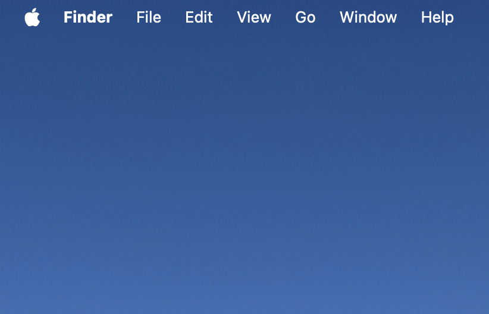
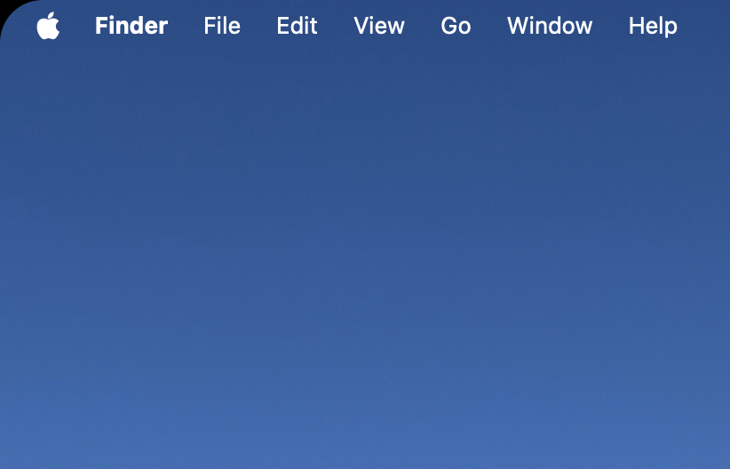

# Rounded Screen

A tiny macOS menu bar app that rounds the corners of your screen, like a laptop display with curved corners.

| Before | After |
| :---: | :---: |
|  |  |

- Adjustable corner radius (0–64 px), applied live, with quick presets in the menu bar menu
- Mouse, clicks and hot corners pass straight through the corners (the overlay is click-through)
- Works on multiple displays, above the menu bar and in full-screen Spaces
- **Run in background**: closing the window keeps the corners active from the menu bar
- **Run at login**: starts hidden when you log in
- **Show in menu bar**: hide the icon if you like; open the app again to bring the settings back
- Pure AppKit, light on memory

## Install

1. Download the latest `RoundedScreen-x.y.z.zip` from [Releases](../../releases).
2. Unzip and move `RoundedScreen.app` to `/Applications`.
3. The app is ad-hoc signed (not notarized), so the first time: **right-click → Open**, or go to *System Settings → Privacy & Security → Open Anyway*. Alternatively:
   ```bash
   xattr -cr /Applications/RoundedScreen.app
   ```

Requires macOS 12 or later.

## Build from source

```bash
git clone https://github.com/<your-username>/RoundedScreen.git
cd RoundedScreen
./build.sh                 # native architecture
UNIVERSAL=1 ./build.sh     # Apple Silicon + Intel
```

Needs Xcode or the Xcode Command Line Tools. The result is `RoundedScreen.app` in the project folder.

## How it works

Each screen gets four tiny borderless windows, one per corner, at the screen-saver window level. Each draws a black square minus a quarter circle. Windows use `ignoresMouseEvents = true`, so they never intercept the pointer.

```
Sources/RoundedScreen/
  Domain.swift                 ScreenCorner, CornerStyle, AppSettings, LoginItem
  CornerWindow.swift           corner view + click-through window
  OverlayController.swift      manages corner windows for every screen
  SettingsViewController.swift settings window (AppKit)
  main.swift                   app delegate, menu bar item
```

"Run at login" writes a LaunchAgent to `~/Library/LaunchAgents/` that starts the app with `--background`.

## Releasing

Push a tag and GitHub Actions builds a universal `.app` and attaches it to a release:

```bash
git tag v1.0.0 && git push --tags
```

## Catatan (Bahasa Indonesia)

Aplikasi menu bar untuk membuat sudut layar Mac jadi membulat. Radius bisa diatur lewat slider, mouse dan hot corner tetap menembus sudutnya, serta ada opsi *Run in background* dan *Run at login*. Unduh `.zip` dari halaman Releases, pindahkan ke `/Applications`, lalu buka dengan klik kanan → **Open** (karena belum dinotarisasi Apple).

## License

MIT
